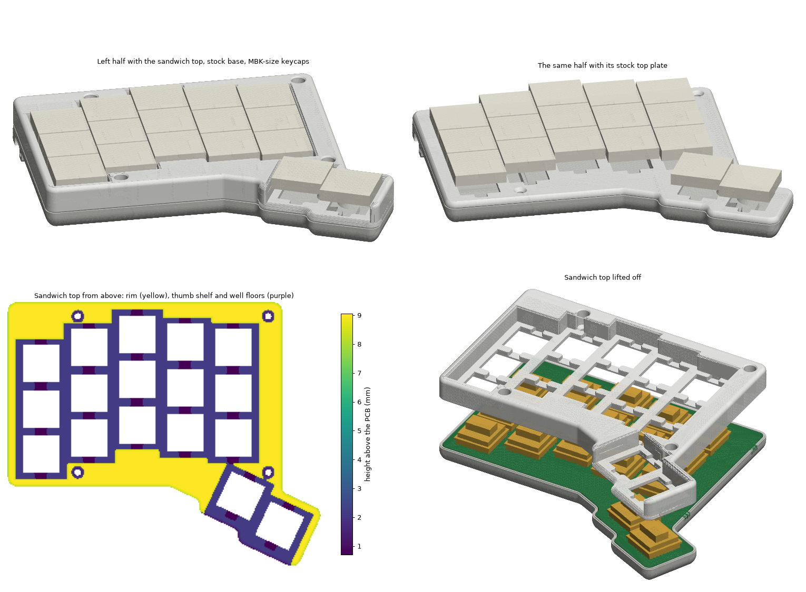
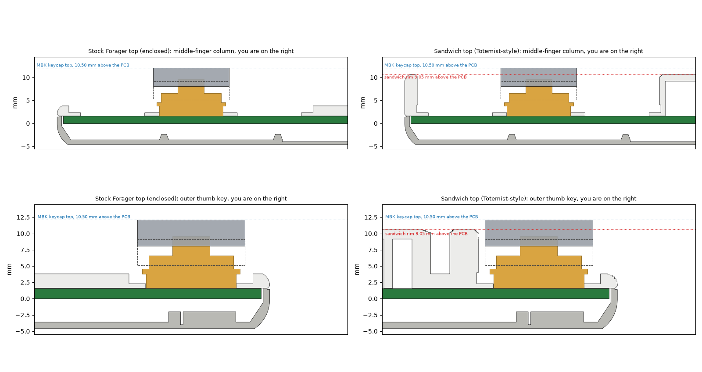

# Sandwich case: Forager

A new top shell for the stock Forager case, in the style of ErgoMech's Totemist (and GEIST's open-source
TOTEM it's derived from). The keycaps sit in wells and the rim comes up to just under their tops, so
from the side the keyboard reads as one solid block instead of keycaps standing on a plate. ErgoMech
calls this a sandwich case.

It replaces only the stock top plate. **The base, PCB, nuts, screws and tenting legs you already have
stay as they are**, so you only need to get two parts made.



## What it keeps from the stock case

- **The plate:** in the wells, the new top *is* the stock top plate. Its switch cut-outs, clip
  chamfers, switch-puller grooves and countersinks are copied from the stock STL, so switches clip
  in and screws seat exactly as before. The only change: the stock plate has a few slivers thinner
  than 0.8 mm next to the thumb keys (carrefinho notes some walls are too thin for some print
  methods). The generator leaves those out, about 15 mm³ per half, so resin services accept the part.
- **The fit:** the outline is the stock case's (checked to 0.0 mm against both stock parts), and the
  4 top screws per half land on the stock seats over the PCB's nuts.
- **The base:** untouched, with its USB-C slot, light pipe, reset lever and magnets for the tenting
  legs.

## What's new: the height

The rim's height is copied from the TOTEM case (measured from GEIST's STEP files), and the Totemist
follows the TOTEM:

| Above the PCB top | Height |
|---|---|
| Plate top (well floor) | 2.2 mm |
| Choc v1 stem top, unpressed | 8.0 mm |
| **Rim top** | **9.05 mm** (TOTEM's: 6.85 mm above the plate) |
| MBK keycap top | 10.5 mm, so the caps stand **1.45 mm** above the rim, as on the Totemist |

On the desk it's 15.3 mm to the rim and 16.7 mm to the keycap tops: the keycaps don't move, and the
whole keyboard stays just under the Totemist's 17 mm. For a rim exactly level with MBK tops,
regenerate with `--rim 10.5`.



Also copied from the TOTEM and Totemist:

- **Wells:** 1.0 mm between every keycap and the wall, a 0.5 mm chamfer on the rim's inside edges
  and a 1.5 mm round on its outside edge. Where columns are staggered, the wall steps with them.
- **Thumb shelf:** in front of the thumb keys there is no rim, just the plate, so the wall can't
  catch your thumbs.
- **Hollow rim:** a 1.5 mm roof on walls and on ribs every 12 mm that rest on the PCB, open
  underneath. It's light and as solid under a finger as the stock plate, and no bridge is wider than
  8.2 mm. There are no closed cavities.
- **Screws:** the 4 top screws go down 4.75 mm holes in the rim to their stock seats, 6.85 mm down.

## Your keycaps

Your Forager has Chosfox caps. The height above is for MBK (3.98 mm tall). To see where yours will
sit, measure on the stock case from the plate's top surface to the top of a keycap: MBK measures
8.3 mm. The sandwich rim is 6.85 mm above the plate, so your caps will stand (your measurement −
6.85) mm above the rim. If you'd like a different look, regenerate with `--rim` set to the height
above the PCB you want: 2.2 + (your measurement) puts the rim level with your keycap tops. Any
Choc-spaced cap up to 17.5 × 16.5 mm fits the wells.

## Files (`stl/`)

| File | Upload? | What it is |
|---|---|---|
| `forager_left_top.stl`, `forager_right_top.stl` | yes | Top shells: 117.2 × 98.9 × 9.05 mm, 19.0 cm³ each |
| `forager_stock_top_template_1to1.svg` | no | Full-size drawing of the stock top plates, for checking your case |
| `forager_preview.png`, `forager_profile.png` | no | Renders and side views |
| `forager_report.json` | no | Check results |

The tops are in the assembly's coordinates, like the stock STLs, so `../enclosed/LBase.stl` and
`forager_left_top.stl` loaded together line up. The base is the stock one: reuse yours, or print
`../enclosed/LBase.stl` and `RBase.stl`.

## Before ordering

PandaKB prints carrefinho's files, but check yours, because the new top must match your base.
Print `stl/forager_stock_top_template_1to1.svg` at 100 % ("actual size"); its scale bar must
measure 50 mm. Unscrew a stock top plate, lay it on its drawing, and check that the outline, the
switch holes and the 4 screw holes (red crosses) line up. If they don't, stop: the new top won't fit.

## Ordering

You don't need a printer. Order the two top STLs like any 3D print. At JLCPCB's 3D printing
(jlc3dp.com): SLA resin, **JLC Black Resin** or a white resin to match a white Forager, quantity 1
of each file, default finish. They're about 38 cm³ together, roughly US$15–40 plus shipping. Paste
this in the order remark:

```text
Keyboard top shells, 2 parts. They screw onto existing parts, so accuracy matters.
Please keep supports and support marks off the top of the rim, the floors of the key wells around
the 14 mm square holes, and the outer side walls. Supports inside the hollow underside are fine.
The square holes and the small chamfers under them are functional: please don't fill, repair or
scale the models. If a part can't be printed this way, please contact me first. Thank you!
```

On a filament (FDM) printer, print them as oriented, plate down, without supports: the walls are
vertical and the roof bridges at most 8.2 mm.

## Swapping the top

1. Pull the keycaps, then the switches (with a switch puller), from the stock top plate.
2. Undo the 4 top screws and lift the stock top plate off. Leave the bottom screws alone: the PCB
   stays in the base.
3. Put the sandwich top on. Press a few switches through their wells into the sockets near the
   corners to line it up.
4. Drive the same 4 screws down the holes in the rim with a hex key or screwdriver long enough to
   reach 7 mm down (the holes are 4.75 mm wide). Snug only: don't crack the print.
5. Press in the rest of the switches until they click into the plate, then fit the keycaps.

The reset lever, USB-C port and light pipe are in the base, so they work as before. Each keycap has
1 mm to the wall; lift one off with a fingernail or a thin plastic pry tool, or use the switch
puller. To go back, swap the stock plate in the same way.

## Regenerating

```sh
python3 -m venv .venv
.venv/bin/pip install manifold3d shapely trimesh numpy matplotlib rtree
.venv/bin/python generate_case.py              # ~15 s, writes stl/
.venv/bin/python generate_case.py --rim 10.5   # rim level with MBK keycap tops
```

`generate_case.py` reads the PCB (`../pcb/forager-pcb.kicad_pcb`) and the stock STLs, copies the
stock plate's details into the wells, and adds the rim with `sandwich.py`, which is the same file in
the Sweep and Fortemis repos. Its `Sandwich(...)` settings include `cap_clear` (1.0), `roof` (1.5),
`wall` / `inner_wall` (1.6 / 1.2), `shelf` (True) and `ribs` (12 mm pitch, 1.2 mm wide).

Every run checks that the top is one watertight piece with no closed pockets, that the plate in the
wells is the stock plate, that the outline and screws match the stock parts and the PCB, and that it
keeps clear of the stock base, the PCB, the switches and MBK keycaps over their full travel.

## Limits

- **Sweat:** the plate still covers the PCB everywhere but under the switches. But the wells hold drops
  on the plate where the stock flat plate lets them run off its edge, the same as on the Totemist, so
  wipe it down.
- **Untested on hardware:** check the fit with the template before ordering.
- **License:** the PCB and stock case are carrefinho's (CERN-OHL-P-2.0, see `../enclosed/LICENSE`).
  The rim heights and clearances follow GEIGEIGEIST/TOTEM's case (CERN-OHL-P-2.0).
